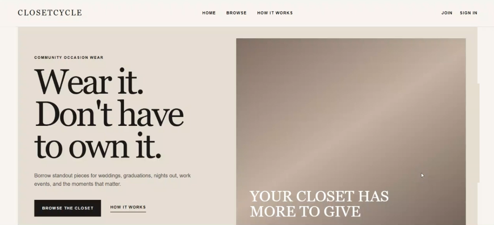
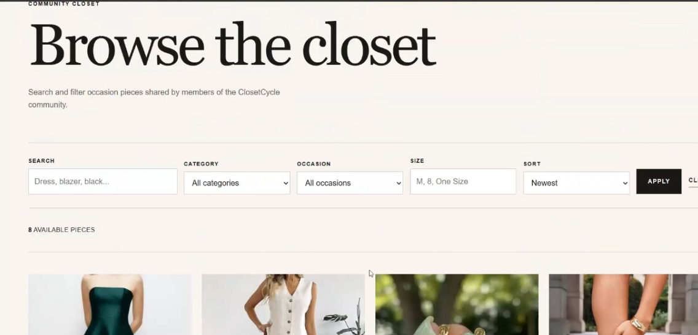
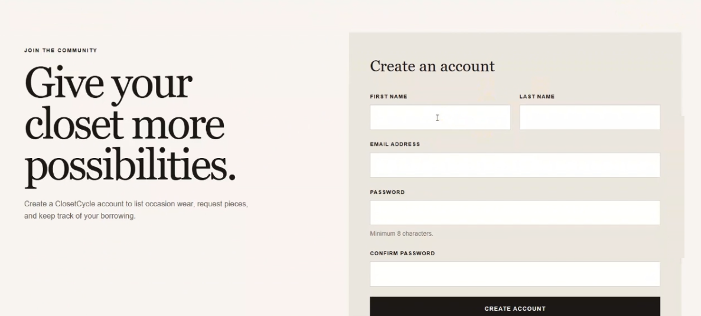
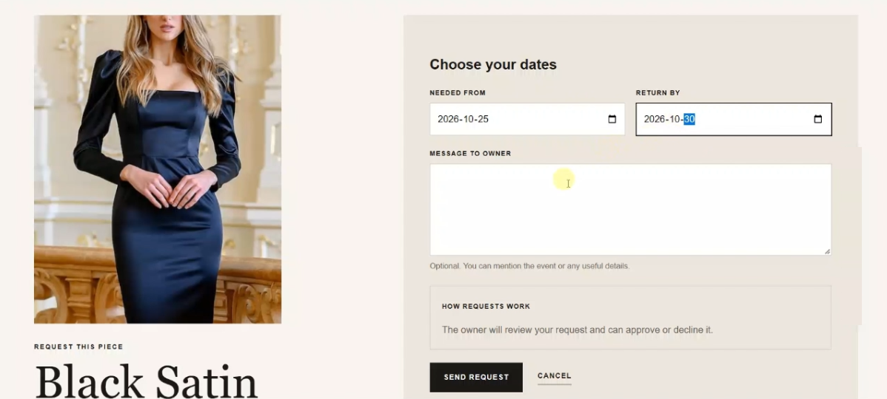
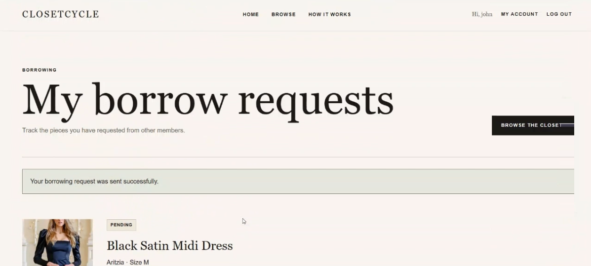
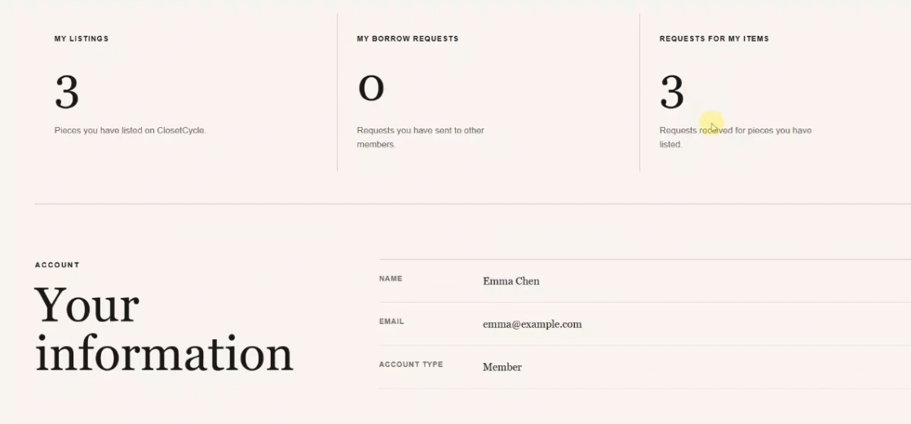
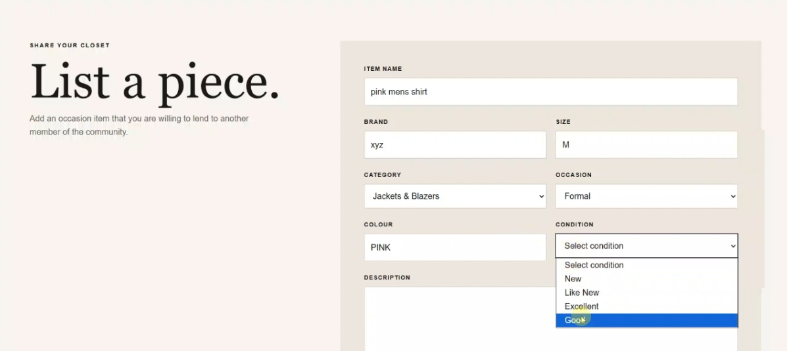
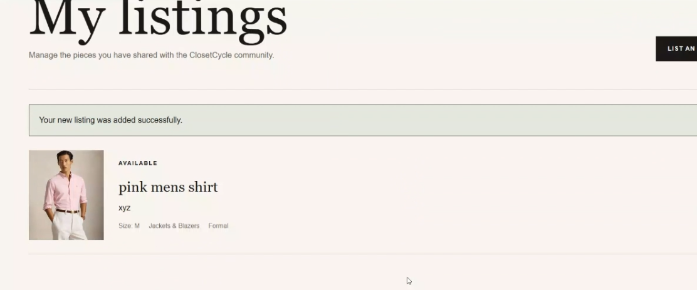
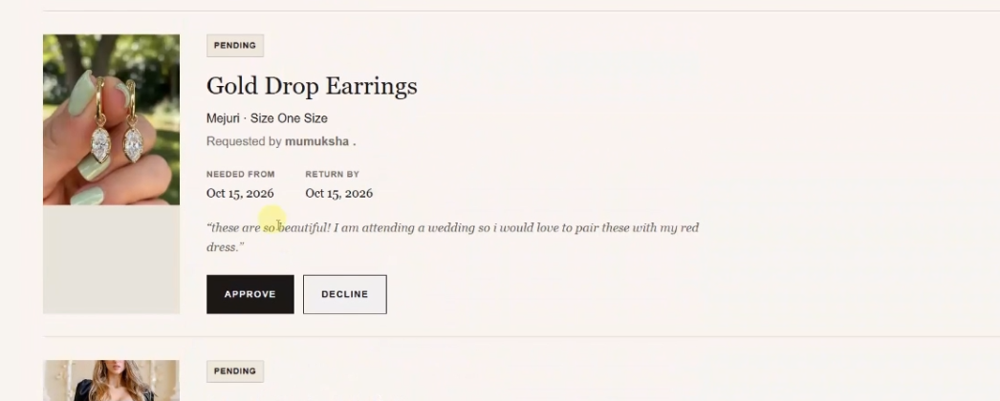
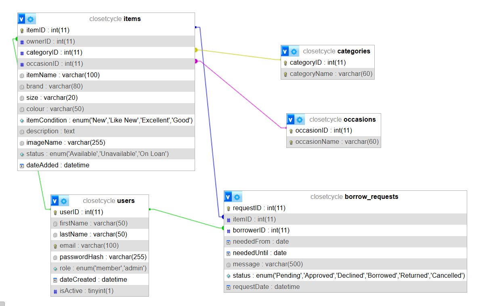

# ClosetCycle

A community platform for lending and borrowing occasion wear. Members list the dresses, suits, shoes and accessories they rarely wear, and other members request to borrow them instead of buying something new for one event.

Built with PHP, MySQL, HTML and CSS. No frameworks or third-party libraries.

## Screenshots

**Home page**

**Browse page with search, category, occasion and size filters, and sorting**

**Listings shared by members**

**Creating an account**

**Requesting an item for chosen dates**

**Tracking the requests you have sent**

**Member dashboard**

**Listing a new item**

**Managing your own listings**

**Approving or declining requests for your items**

## Features

- Registration, login and logout with PHP sessions
- Passwords stored with `password_hash()` and checked with `password_verify()`
- Member and admin roles, with protected pages for each
- Create, edit and delete listings, with image upload (JPG, PNG, WebP) validated by type and size
- Search by keyword, filter by category, occasion and size, and sort results
- Borrow request workflow: Pending, then Approved, Borrowed and Returned, or Declined or Cancelled
- Admin area for managing users, listings and categories
- PDO prepared statements for all database input

## Rules the app enforces

- Members cannot request their own listing.
- A member can have only one active request per item.
- Approving one request declines the other pending requests for that item.
- A listing with an active request cannot be deleted.
- A category in use by a listing cannot be deleted.
- Members can only edit or delete their own listings.

## How the code is organized

| Folder | What it holds |
|---|---|
| `models/` | PHP classes for the database, users, items, categories, requests and image upload |
| `views/` | Page templates for public, member, login and admin pages |
| `account/` | Page controllers for logged-in members |
| `admin/` | Page controllers for admins only |
| `config/` | Database and application settings |
| `public/` | CSS, default image and uploaded listing images |
| `database/` | SQL export with sample data |

## Database

Five tables: users, items, categories, occasions and borrow_requests.

## Run it locally

You need XAMPP (PHP 8.2 and MariaDB or MySQL).

1. Copy the `ClosetCycle` folder into `C:\xampp\htdocs\`.
2. Start Apache and MySQL in the XAMPP Control Panel.
3. In phpMyAdmin, import `database/closetcycle.sql`.
4. Open `config/config.php` and set `DB_USER` and `DB_PASS` to your own MySQL login (XAMPP's default is `root` with an empty password).
5. Visit `http://localhost/ClosetCycle/`.

Sample accounts (local demo data only):

| Role | Email | Password |
|---|---|---|
| Admin | admin@closetcycle.local | sesame |
| Member | emma@example.com | closet123 |
| Member | noor@example.com | closet123 |

## About

Built by Mumuksha as a final project for a web development course at Thompson Rivers University, 2026.
